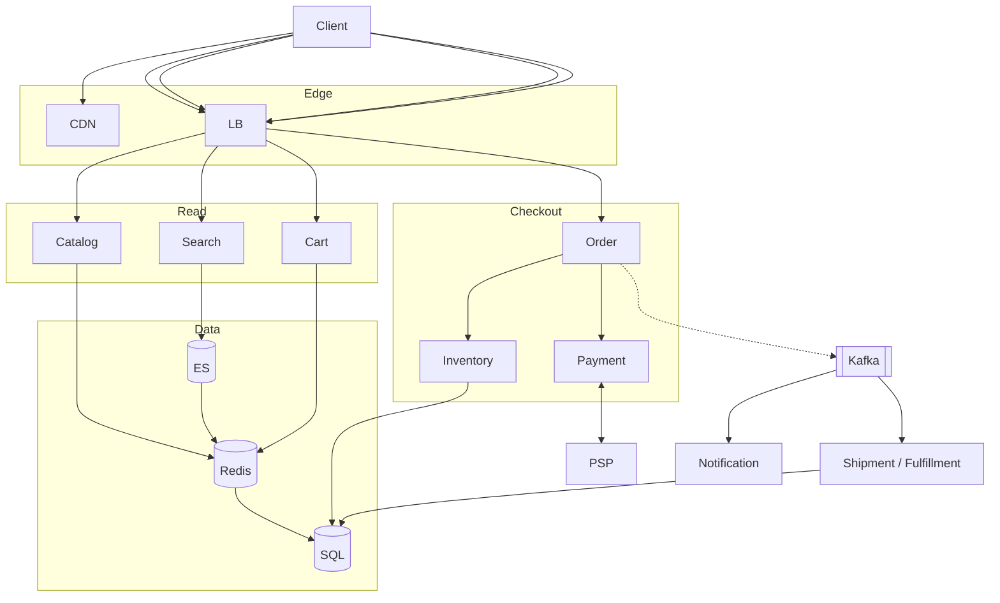

# **Amazon — E-commerce — HLD**

> **Read-heavy** browse/search/cart; **write path** = place order + **atomic inventory** + **payment service** (see `Payment System — HLD.md`). Search = `Search — HLD.md`. **Do not reserve stock in cart** — reserve/decrement at checkout/pay.

---

## **1\. Requirements**

### **Functional** *(user facing)*

* **Browse** categories, **search**, view product page (price, images, in-stock hint).
* **Cart** — add/update/remove; guest cart merge on login.
* **Checkout** — address, summary, **place order**, pay online (or COD if product supports).
* **Track order** — placed → paid → shipped → delivered; cancel/return per policy.

### **Non-functional**

* High availability on **browse**; **fail closed** on checkout if inventory cannot be verified.
* **Idempotent** place-order; durable orders; PCI — card data only at **PSP**.
* PDP/search **eventually consistent**; **inventory + order + pay** strong on write path.

---

## **2\. API end-to-end flows**

### **Read path** — browse / search / PDP *(shallow — reuse Search HLD)*

```text
GET /products/{id}  → Catalog → Redis PDP cache → SQL
GET /search?q=      → Search API → ES → ids → PDP hydrate (query + PDP caches)
GET /cart           → Cart service → Redis
```

*SERP “in stock” is a **hint**; checkout re-checks inventory.*

---

### **POST /v1/cart/items** — add to cart

```text
1. Cart service updates Redis lines (user_id or guest session_id)
2. No inventory reservation — only validates SKU exists (optional)
```

---

### **POST /v1/orders** — place order *(core interview path)*

**Headers:** `Idempotency-Key`. **Caller:** Client after checkout review.

*(Creates `order_id`, status **PAYMENT_PENDING** — same idea as payment doc: order exists before pay.)*

```text
1. Client → POST /orders { cart_id, address, payment_method }
2. Order service: idempotency_key → same retry returns same order_id
3. Order service → Inventory: reserve/decrement per SKU × eligible warehouse for pincode
     conditional SQL (available >= qty) — 0 rows → 409 sold out, abort
4. Persist order + order_items (price snapshot) in SQL — PAYMENT_PENDING
5. Order service → Payment service POST /payments { order_id, amount, method }  (Payment HLD)
6. Return order_id + payment_id + PSP checkout URL / PENDING
7. PSP webhook → payment SUCCEEDED → order PAID (idempotent on payment_id)
8. Publish **order.paid** → Kafka (async — not blocking “thank you” page)
```

**Inventory:** finalize on **successful pay** (or reserve at step 3 + commit on PAID — state policy aloud; both common).

---

### **After PAID — shipment / fulfillment** *(async, high level)*

**Consumer:** `order.paid` → **Shipment / Fulfillment service** (separate from checkout).

```text
1. Pick warehouse from order_items + pincode rules (may differ per seller 3P)
2. Create shipment(s): order_id, tracking_id, status READY_TO_PACK → SHIPPED → OUT_FOR_DELIVERY → DELIVERED
3. Persist shipments table; decrement / confirm inventory at warehouse if not already final at pay
4. Hand off to carrier API (label, tracking); update order status via same service or order consumer
5. Notification service → user “shipped” / “out for delivery” (Notification HLD)
6. Client: GET /orders/{id} shows timeline (payment already PAID; shipping lags OK)
```

*Money path ends at **Payment HLD**; **shipment** is post-pay logistics — same pattern in Swiggy (dispatch) and Ticket (digital QR) with different “deliverable.”*

---

### **GET /v1/orders/{order_id}**

```text
Poll order + payment_status while PAYMENT_PENDING; source of truth after pay lag on email
```

**Other (list only):** cancel/return · reviews · wishlist P1.

---

## **3\. High-Level Architecture**



```text
Read:  CDN · Catalog/Search/Cart → Redis · ES · SQL
Write: Order → Inventory → Payment (PSP) — sync critical path
Async: order.paid → Shipment/Fulfillment · Notification · analytics
```

---

## **4\. Data Model** *(core)*

| Entity | Notes |
|--------|--------|
| **orders** | `order_id`, user, status, `payment_status`, address snapshot, total |
| **order_items** | sku, qty, **unit_price_snapshot**, seller_id |
| **inventory** | `(sku_id, warehouse_id)` available_qty; pincode → eligible warehouses |
| **cart** | Redis: user or session → lines |
| **payments** | via payment service / `payment_id` link |
| **shipments** | `shipment_id`, `order_id`, warehouse, tracking, status (post-PAID) |

---

## **5\. Deep dives** *(what they drill)*

### **No oversell (flash sale)**

* **Not in cart** — two users can cart last unit; **one wins at place-order**.
* `UPDATE … WHERE available >= n` (or reserve row + TTL at checkout start).
* **Inventory service down** → **reject place order** (fail closed), don’t guess stock.

---

### **Stale PDP vs checkout**

* Search/cache may show “in stock”; **step 3** is truth. User sees sold out at place-order if lost race.

---

### **Payment saga** *(pointer to Payment HLD)*

* **Paid, order not updated** → Kafka retry / idempotent consumer; **don’t double-charge**.
* **Pay succeeded, inventory finalize fails** → compensate (release reserve / refund) + ops.
* **Idempotency-Key** on `POST /orders` and payment create.

---

### **After PAID — async**

* **Shipment service** owns pack/ship/tracking; order row moves **PAID → SHIPPED → DELIVERED** (event-driven).
* **Notification** for milestones; user truth = **GET /orders** (email can lag).
* Search indexer / analytics — same Kafka fan-out; never block pay response.

---

### **Failure (compact)**

| Failure | Behavior |
|---------|----------|
| Redis cart down | Fall back SQL or read-only cart error |
| ES down | Category browse fallback; search degraded |
| Pay PENDING | UI poll order; no “success” until PSP proof |

**Monitor (one line):** checkout success rate, sold-out at place-order, payment PENDING age, inventory negative qty.

---
