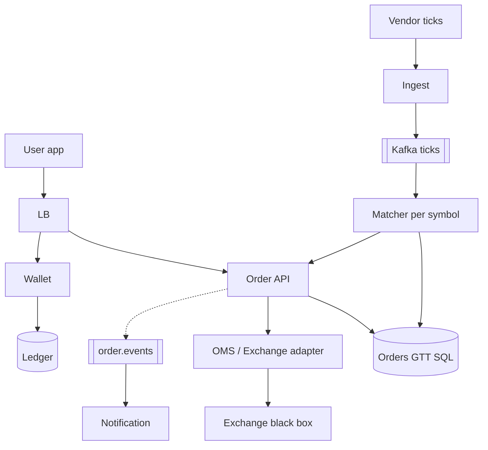

# **Broker App (Groww-style) — HLD**

> You are a **broker** between **user** and **exchange** (NSE/BSE via **OMS / vendor API** — black box). **Wallet** holds cash (liability ledger — Payment HLD slice). **Ticks** from exchange drive **matching** for open **LIMIT** and **GTT** orders. **Alerts** = notify only (optional); **GTT** = real order when trigger hits.

---

## **1\. Requirements**

### **Functional** *(user facing)*

* **Buy / sell** stocks — **market** (now) or **limit** (at price or better).
* **GTT** — “when price hits X, place buy/sell” (good till triggered / cancelled); e.g. sell when RELIANCE ≥ ₹2500.
* **Wallet** — add funds, see balance; **withdraw** to bank (policy + settlement).
* **Holdings** — after **settlement (T+1)** shares/cash reflect in app (trade day vs settlement day).
* **Order status** — placed, queued, partial fill, executed, rejected.
* **Price alerts** *(optional)* — push when price crosses level **without** placing order (Notification HLD only).

### **Non-functional**

* **Correctness** on money and qty — no double spend, no sell without holdings.
* **Low latency** submit ack; matching driven by **live ticks** (next tick may change price).
* **High concurrency** — many users × many symbols; **shard by symbol** for matching.
* **Fail closed** on wallet/withdraw when ledger unknown.

---

## **2\. API end-to-end flows**

### **POST /v1/orders** — intraday / regular order

**Headers:** `Idempotency-Key`. Body: `symbol`, `side` BUY|SELL, `type` MARKET|LIMIT, `qty`, `limit_price?`.

```text
1. Client → Order API
2. Pre-checks (sync): auth, market hours, symbol tradable
3. Wallet: BUY → block/debit margin (available cash ≥ est. cost); SELL → holdings ≥ qty (or intraday product rules)
4. Insert order row PROCESSING in SQL (your truth for UI immediately)
5. Return 202/200 { order_id, status: PROCESSING }  ← user can GET right away
6. Async or sync to OMS/exchange API:
     SUBMITTED → QUEUED → PARTIAL_FILLED → FILLED | REJECTED | CANCELLED
7. On each exchange callback / poll: update SQL + wallet/holdings (fills)
8. Publish order.events → Kafka (notifications, analytics) — not blocking step 5
```

*User **never** waits on exchange in HTTP thread for seconds — show **your** status from DB.*

---

### **POST /v1/orders/gtt** — Good Till Triggered

```text
1. Client → { symbol, side, qty, trigger_price, limit_price?, type STOP_LOSS_LIMIT | BUY_TRIGGER }
   Example sell GTT: trigger when LTP >= 2500 → place LIMIT sell at 2498
   Example buy GTT:  trigger when LTP <= 1800 → place LIMIT buy at 1802
2. Validate wallet/holdings for eventual side (reserve sell qty or buy funds — product rule)
3. Insert gtt_order ACTIVE in SQL (not sent to exchange yet)
4. Return gtt_id, status ACTIVE
```

**Trigger path (tick-driven, not user HTTP):**

```text
1. Exchange/vendor feed → your Ingest service → Kafka topic (e.g. market-ticks); message key = symbol
2. Matcher consumer group: one tick message = one symbol S, LTP P
3. Update Redis quote:S; load ACTIVE gtt_orders for S only (indexed SQL or in-memory on shard)
4. For each rule where trigger met: UPDATE ACTIVE→TRIGGERED (once) → child order → POST /orders flow → OMS
5. Notification optional (alerts: same tick path, no OMS)
```

*GTT = **conditional order stored in your DB** + **matcher on ticks**. Alert = step 5 notify only, **no** OMS submit.*

---

### **GET /v1/orders/{order_id}** — user polls after place

```text
Read SQL only: PROCESSING | SUBMITTED | OPEN | PARTIAL | FILLED | REJECTED + filled_qty, avg_price, reason
Never block on live exchange round-trip in GET
```

---

### **POST /v1/wallet/withdraw**

```text
1. Check settled balance (not same-day unsettled sell proceeds if policy)
2. Debit wallet via ledger txn; payout to bank (PSP/bank rail) — Payment HLD slice
3. Status PENDING → COMPLETED on bank callback
```

---

### **Settlement (T+1)** — internal / batch

```text
Trade day: fills update "pending settlement" holdings
T+1 morning: clearing/settlement job (exchange files or OMS report)
  → move shares to demat / cash to wallet available
  → user can withdraw sell proceeds
```

*Interview: **trade** instant in app as “executed”; **withdrawable** money follows **settlement** rules.*

---

### **POST /v1/alerts** *(optional — not GTT)*

```text
Symbol + threshold → SQL; tick matcher → Notification only (no OMS order)
```

---

## **3\. High-Level Architecture**



```text
Place order: API → wallet check → SQL PROCESSING → OMS (async) → updates SQL
GTT: SQL ACTIVE until tick → matcher → child order → OMS
Ticks: never scan all users — load ACTIVE orders/GTT for that symbol only
```

---

## **4\. Data Model** *(core)*

| Entity | Notes |
|--------|--------|
| **orders** | `order_id`, user, symbol, side, type, qty, filled_qty, status, `idempotency_key`, exchange_ref |
| **gtt_orders** | symbol, trigger, limit, side, ACTIVE\|TRIGGERED\|CANCELLED, `child_order_id?`; index `(symbol, status)` for matcher |
| **wallet / ledger** | available vs blocked vs unsettled (Payment-style) |
| **holdings** | symbol, qty, avg_cost; pending_settlement qty |
| **quote:{symbol}** | Redis last trade price from ticks |

---

## **5\. Deep dives** *(Grow interview — concurrency & consistency)*

### **Broker vs exchange**

* **Grow** = KYC, wallet, UI, risk checks, route orders.
* **Exchange** = order book, matching, official fills. You consume **ticks + fill callbacks**.
* **LIMIT** on book → exchange; **GTT** → your DB + matcher → **child** order to OMS.

---

### **Ticks & GTT matching** *(interview depth)*

**What is `symbol`?** Ticker for **one** instrument (e.g. `RELIANCE`, `TCS`; may be `NSE:RELIANCE`). Every order, GTT row, and tick carries it. Matching = *“on this price update for S, which rules fire?”* — **never** scan all users app-wide.

**Who produces Kafka ticks?** Exchange does **not** write to your cluster. **Ingest** subscribes to exchange/vendor market-data feed, normalizes, **produces** to **your** Kafka. Matcher consumers read that stream (no per-user exchange polling).

**Kafka shape (default story):**

| Wrong assumption | Correct pattern |
|------------------|-----------------|
| One Kafka topic per stock | **One topic** (e.g. `market-ticks`) |
| Topic name = symbol | Message **key** = `symbol` → same key → same **partition** → ordered ticks per stock |
| Every consumer runs duplicate SQL on same tick | **Consumer group** `gtt-matcher`: each partition handled by **one** worker |

```text
Vendor/exchange feed → Ingest → Kafka "market-ticks" (key=RELIANCE|TCS|…)
                                      ↓
              Consumer group (N workers, 1 consumer per partition)
                                      ↓
         Message { symbol: RELIANCE, ltp, exchange_ts } → only RELIANCE ACTIVE GTTs
```

**GTT storage & per-tick work:**

1. Create GTT → row in **`gtt_orders`** (`ACTIVE`); not on exchange until triggered.
2. Intraday: ticks stream continuously during market hours; scale consumers with partitions.
3. Per message: update **`quote:{symbol}`** in Redis (one LTP per symbol for whole app) → evaluate ACTIVE rules **for that symbol only** (`WHERE symbol = ? AND status = ACTIVE`, index on `(symbol, status)`).
4. Trigger: sell GTT often `P >= trigger`; buy GTT `P <= trigger` → atomic `ACTIVE → TRIGGERED` → child order → OMS.

| Interview question | Answer |
|--------------------|--------|
| SQL on every tick? | **Yes logically** per symbol on that tick; at high tick rate add **in-memory rules on matcher shard** + DB for durability / `TRIGGERED` |
| Query all stocks each tick? | **No** — one message = one symbol |
| Millions of GTT? | Spread across **~1–2k+** listed symbols (not millions of stocks); cost is **O(rules on that symbol)** |
| Hot symbol (many GTTs) | Optional: index triggers by price; only rules crossed between old LTP and new LTP |

**Guards:** stale tick (don’t trigger); duplicate tick (`TRIGGERED` once); Kafka down → **fail closed** (no guessed triggers).

**5-min speak drill:** GTT ACTIVE in SQL → ingest tick keyed by symbol → Redis LTP → match that symbol only → TRIGGERED + child → OMS → GET order = SQL status.

---

### **Immediate GET after place — what to show**

| Moment | User sees |
|--------|-----------|
| Right after POST | **PROCESSING** / **SUBMITTED** (your DB) |
| Exchange slow | Still SUBMITTED — poll GET; push on FILLED |
| Reject | **REJECTED** + reason (insufficient margin, halted symbol) |

*Never show FILLED until exchange confirmation persisted.*

---

### **Concurrency at scale**

* **Partition matching by `symbol`** — one matcher consumer per partition (Kafka key = symbol).
* **Per-user idempotency** on place — retry POST → same `order_id`.
* **Wallet / holdings:** row lock or `UPDATE … WHERE available >= qty` — two buys cannot spend same cash.
* **GTT trigger:** `UPDATE gtt SET status=TRIGGERED WHERE gtt_id=? AND status=ACTIVE` — only one child order.
* Hot symbol (NIFTY): many GTTs — still O(rules for symbol), not O(all users).

---

### **Sync vs Kafka**

| Path | Pattern |
|------|---------|
| **Place order HTTP** | Sync **validation + DB insert**; **OMS submit** async worker or short timeout + callback |
| **Ticks** | **Must** be Kafka/stream — cannot poll exchange per user |
| **Kafka down** | No GTT/limit trigger updates → **don’t fire false triggers**; new market orders **fail closed** or queue with cap; show DEGRADED |
| **Fill updates** | Webhook from OMS → update SQL + wallet (idempotent fill_id) |

---

### **MARKET vs LIMIT vs GTT**

* **MARKET** — send to OMS now at current book.
* **LIMIT** — rests in book until price matches (exchange) or you simulate with tick matcher for app-only MVP (say exchange handles in real design).
* **GTT** — **stored trigger**; on tick cross → spawn **LIMIT/MARKET child** once.

---

### **Buy vs sell GTT**

* **Sell GTT:** need **holdings** (or product allows sell-before-buy intraday).
* **Buy GTT:** on trigger, need **cash** at fire time — block/reserve policy at GTT create vs at trigger (state aloud).

---

### **Settlement T+1**

* **Executed** ≠ **withdrawable** until settlement job runs.
* Wallet fields: `available`, `blocked`, `unsettled_credit`.

---

### **Alerts vs GTT**

* **Alert:** tick match → **notification** only.
* **GTT:** tick match → **real order** → OMS → fill → wallet/holdings.

---

### **Failure (compact)**

| Failure | Behavior |
|---------|----------|
| OMS timeout | Order SUBMITTED; reconcile poll; user not double-charged |
| Duplicate fill webhook | Dedupe `fill_id` |
| Stale tick | Don’t trigger GTT if ts old |

**Monitor (one line):** order PROCESSING age, matcher lag, reject rate, wallet negative (zero tolerance).

---
