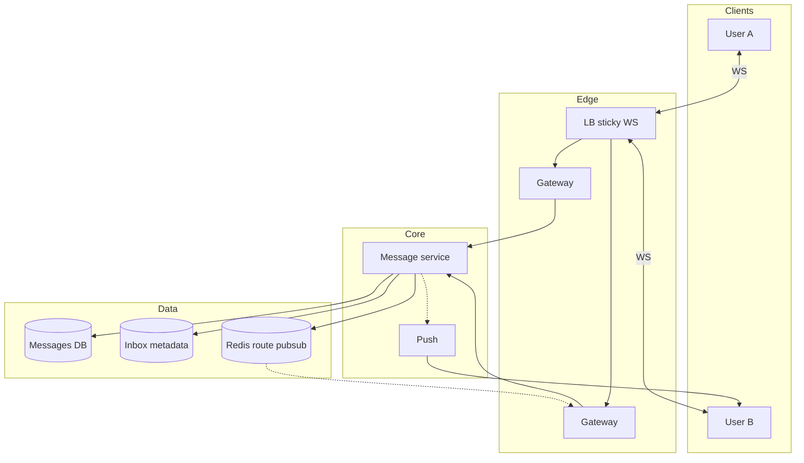

# **Chat / Messenger — HLD**

> **WebSocket** for online delivery; **message DB** = truth; **gateway** holds connections only. **Offline** = persist + push notification; catch-up via **REST sync** (`after_seq`). Order is **per conversation**, not global.

---

## **1\. Requirements**

### **Functional** *(user facing)*

* Send and receive **1:1 and group** messages in near real time.
* **Delivery** and **read** indicators; see **online / last seen** (policy).
* **History** on new device or after reconnect; **push** when app is in background / offline.

### **Non-functional**

* Low latency for online users; **horizontal scale** (many gateways, shard by conversation).
* **Per-chat ordering**; tolerate **at-least-once** with client **`client_message_id`** dedupe.
* Connection churn (reconnect, multi-device).

---

## **2\. API end-to-end flows**

### **WebSocket** — send & receive *(hot path)*

**Caller:** Client. `wss://…/connect` (auth); sticky **chat gateway**.

```text
1. Client opens WS → gateway registers user_id → Redis (user → gateway_id)
2. Client sends MESSAGE { conversation_id, client_message_id, body }
3. Gateway → Message service
4. Message svc: dedupe client_message_id → assign server_seq → append DB (conversation partition)
5. Update user_inbox rows (preview, unread) per member
6. Recipient online? Redis lookup gateway → WS fan-out (same gateway or pub/sub to peer gateway)
7. Recipient offline? → Push service (FCM/APNs) + message already durable in DB
8. Sender ack with server_seq; recipient DELIVERED/READ events back through WS
```

---

### **POST /v1/conversations/{id}/messages** — fallback send

```text
Same steps 4–7 as WS when client cannot use socket (upload retry, background task)
```

---

### **GET /v1/conversations/{id}/messages?after_seq=&limit=** — sync / gap fill

```text
1. After reconnect or new device: client passes last known server_seq
2. Message svc reads DB conversation_id partition → returns ordered batch
3. Client merges; fixes gaps if push/WS missed a packet
```

**Other (list only):** `POST /conversations` (create DM/group) · `POST /push/register` (device token) · inbox list API (reads `user_inbox`).

---

## **3\. High-Level Architecture**



```text
Client ⇄ Gateway (WS) → Message svc → DB
                      → Redis → peer Gateway
                      → Push if offline
REST sync → Message svc → DB
```

---

## **4\. Data Model** *(core)*

| Entity | Purpose |
|--------|---------|
| **conversations** | `conversation_id`, DM\|GROUP, members |
| **messages** | `conversation_id`, **`server_seq`**, sender, **`client_message_id`** UNIQUE per sender, body, ts — shard **`conversation_id`** |
| **user_inbox** | per user: `conversation_id`, last_preview, unread, last_seq — fast inbox list |
| **receipts** | `(message_id, user_id)` → DELIVERED \| READ (group = per recipient) |
| **presence** | Redis `presence:{user_id}` TTL |

---

## **5\. Deep dives** *(what they drill)*

### **Ordering (per conversation)**

* **`server_seq`** monotonic per `conversation_id` (DB txn or per-shard counter) — every stored message gets the next integer in that chat.
* Clients sort by `seq`; **no global order** across chats.
* Client keeps **last received `server_seq`** per conversation; on reconnect **`GET ?after_seq=last`** returns only **new** messages (catch-up from where they left off).
* Gap: client sees seq 5 then 7 → **GET after_seq=5** to backfill.

---

### **Idempotency & duplicates**

* Same **`client_message_id`** from sender retry → return existing message (no double bubble).
* WS + REST duplicate submit → same rule.

---

### **Gateway scale & fan-out**

* Gateway **does not** own history — only connections.
* **Redis:** `user_id → gateway_id`; cross-gateway fan-out via **Redis pub/sub** or internal bus.
* **Group:** one DB write → fan-out to N members (N WS pushes or N inbox updates).

---

### **Offline & multi-device** *(maps to LLD `SocialChat` offline buffer)*

| LLD (in-process) | HLD (distributed) |
|------------------|-------------------|
| User offline → messages sit in **per-user offline buffer** | User offline → messages still **written to DB** (durable “buffer”) |
| User **registers session** → flush buffer to `UserSession` / WS | User **reconnects** → **`GET messages?after_seq=`** loads everything since last seq (same idea as flush) |
| — | **Push** (FCM/APNs) = wake app only; **body comes from DB sync**, not from push queue |

**Flow when recipient is offline:**

```text
1. Message service always APPENDS to DB (server_seq assigned) — same as “accepted” in LLD
2. Live WS delivery skipped (no gateway for user / presence offline)
3. Optional: push notification “new message” (notification system)
4. User opens app → WS connect + sync after_seq → receives all missed rows from DB
```

*There is usually **no** separate per-user Kafka queue for chat text — **the message table + seq** is the offline store. (Delivery retry queues are optional; not required in the interview default.)*

**Multi-device:** all sessions for user get live WS when online; each tracks **last seq**; read on one device → receipt to sender + other devices catch up.

---

### **Failure handling**

| Failure | Behavior |
|---------|----------|
| Gateway crash | Client reconnect (sticky may change); resume **after_seq** |
| DB OK, WS push fail | Message safe; retry fan-out; client pull fills gap |
| Redis routing stale | Missed live push → sync API still works |

**Monitor (one line):** connected users/gateway, store→deliver lag, push success, seq gap rate.

---

### **Out of scope unless asked**

* **E2E encryption** — server can’t read body; metadata/receipts only.
* **Media:** pre-signed object upload; message holds `media_key` (same as YouTube pattern).

---
