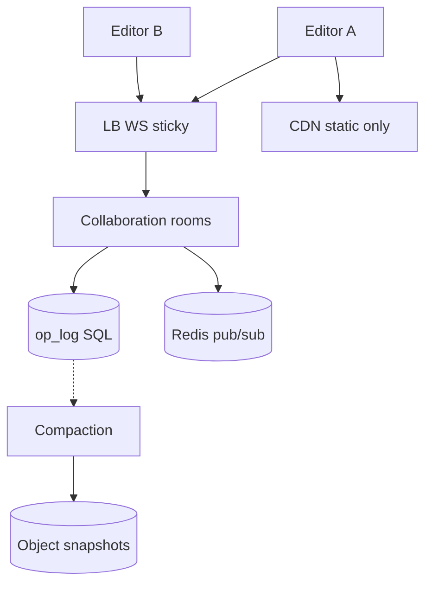

# **Google Docs — Collaborative Editing — HLD**

> Many users edit **same doc** in real time. **WebSocket** hot path; **op log** = durable truth (append per accepted op). **OT or CRDT** so concurrent edits don’t last-write-wins the whole doc. **Snapshots** to object storage = async compaction, **not** “save only when room empty.”

---

## **1\. Requirements**

### **Functional** *(user facing)*

* Create / open doc; **real-time** text edits; multiple simultaneous editors.
* **Presence** — cursors / selection (ephemeral).
* **ACL** — who can view / edit.
* **Revision history** / restore to past revision (P1).
* Comments, export PDF (P1 — separate or op types).

### **Non-functional**

* Low op round-trip latency (tens–low hundreds ms p95).
* Scale by **`doc_id`** (shard op log, room fan-out).
* **Durable** edits survive server crash — no “only persist when last user leaves.”
* Idempotent client ops (`client_op_id`).

---

## **2\. API end-to-end flows**

### **GET /v1/docs/{doc_id}** — open (cold start)

```text
1. HTTP: auth + ACL check
2. Return metadata, latest_revision, snapshot pointer
3. GET /snapshot (object storage or cache) — base document state
4. GET /ops?after_revision=r OR replay over WS after JOIN — catch up to head
5. Client applies ops in server_revision order (OT) or merge (CRDT)
6. Open WebSocket to collaboration service (sticky LB or any node + Redis pub/sub)
```

---

### **WebSocket** — JOIN + OP *(hot path)*

```text
1. JOIN { doc_id, last_known_revision }
   → snapshot + missed ops if behind; else “current”
2. Client types → OP { client_op_id, base_revision, op_payload }
3. Server: validate ACL; OT transform or CRDT merge if base_revision < head
4. Assign server_revision++; append op_log (durably) — ACK after durable append
5. Broadcast transformed op to room (same node or Redis pub/sub doc:{doc_id})
6. Peers apply remote ops in revision order
7. PRESENCE { cursor, selection } — throttle ~10–20 Hz; not merged with text via OT
8. LEAVE — disconnect only; does NOT mean “flush to S3 now”
```

*CDN = static client assets / **read-only** export blobs — **not** live edit bytes.*

---

### **Compaction** — background (not user-triggered save)

```text
1. Worker on schedule or revision threshold (e.g. every N ops or nightly)
2. Replay op_log → merged document blob
3. PUT snapshots/{doc_id}/rev_{n} object storage; update latest snapshot pointer
4. Trim / archive old ops per retention policy
5. Edits already safe in op_log while users are typing — snapshot is for fast open + cost
```

---

## **3\. High-Level Architecture**



```text
Write: WS OP → order/OT/CRDT → append op_log → fan-out peers
Read open: snapshot + replay ops · Reconnect: JOIN + after_revision
```

---

## **4\. Data Model** *(core)*

| Entity | Notes |
|--------|--------|
| **documents** | `doc_id`, owner, ACL, `latest_revision`, `snapshot_key` |
| **op_log** | `doc_id`, **`server_revision`**, `client_id`, **`client_op_id`** UNIQUE per client, `op_json`, ts — append-only, shard **`doc_id`** |
| **snapshots** | object storage `rev_n` — compacted state |
| **presence** | Redis TTL / ephemeral — not durable op_log |

**Delete / history:** tombstone op or retain in log for restore until compaction policy.

---

## **5\. Deep dives** *(interview drills)*

### **Wrong model: “save when users = 0”**

* **Correct:** every accepted op → **append op_log** soon after accept (crash-safe).
* **Background job:** **snapshot/compaction** to object storage — async, on threshold/schedule — **not** the only persistence.

---

### **OT vs CRDT** *(pick one in interview)*

| | **OT** | **CRDT** |
|---|--------|----------|
| Idea | Server **total order** (`server_revision`); **transform** concurrent ops (e.g. two inserts at index 5). | Mergeable structures; replicas **merge** without central transform matrix. |
| Say | “Central revision++; transform late op so both inserts survive.” | “Per-char / rope IDs; merge without index fights; good for offline.” |

**Line:** Two users same region → **not** LWW whole doc → **OT or CRDT**.

---

### **Concurrent edit flow (OT)**

```text
1. Op carries base_revision (parent state server applies against)
2. If base_revision < head → transform op against ops since base
3. Append, broadcast with new server_revision
4. Clients buffer local ops; transform against concurrent remote ops (client OT) or wait for server ack
```

---

### **WebSocket scale**

* **Sticky** session to collaboration node holding room state **or**
* **Stateless** nodes + **Redis pub/sub** `doc:{doc_id}` for cross-node broadcast.
* Heartbeat; reconnect → JOIN + `last_known_revision` + DB catch-up.

---

### **Presence vs text**

* Cursors = **PRESENCE** messages; throttle; LWW or drop under load.
* **Do not** run full OT on cursor positions with text ops.

---

### **Failure (compact)**

| Failure | Behavior |
|---------|----------|
| Collab node dies | Client reconnect; JOIN + replay from op_log |
| Redis pub/sub down | Degraded fan-out on one node; DB still truth |
| ACK before durable append | **Don’t** — risk lost edits on crash |
| Compaction fails | Edit still works via op replay; retry snapshot |

**Monitor (one line):** WS disconnect rate, op accept p95, op_log lag vs client revision, compaction age vs head.

---
