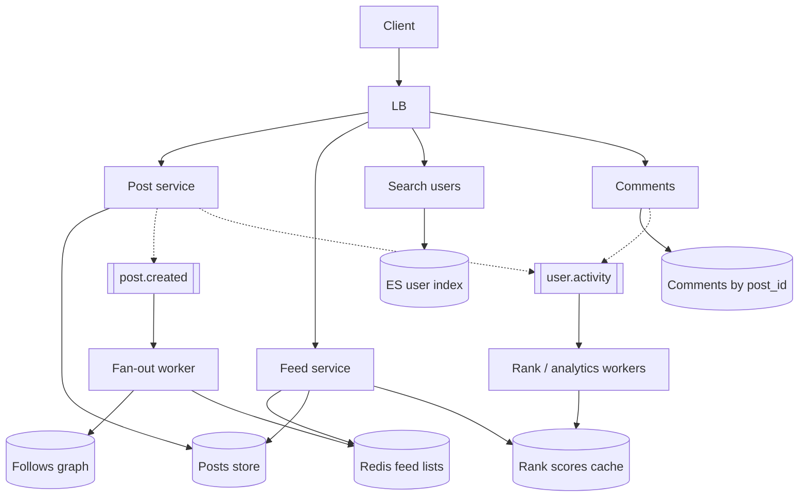

# **News Feed — HLD** *(Instagram / Twitter home timeline)*

> **Read-heavy:** many **GET /feed**, few **posts**. Core interview topic = **fan-out on write vs read** (+ **hybrid** for celebrities). **Engagement:** like, comment, share. **Profile search** → `Search — HLD.md`. **Ranking:** `user.activity` / `engagement.events` → Kafka → batch or near-line rank features (not ML in room). **Eventually consistent** timeline; **cursor** pagination.

---

## **1\. Requirements**

### **Functional** *(user facing)*

* **Post** content; **follow** people; see **home feed** (newest / ranked).
* **Search** people / profiles (Search HLD).
* **Like**, **comment**, and **share** on posts.
* View **profile** timeline; mute/block (P1).

### **Non-functional**

* Fast feed load at scale; tolerate **seconds lag** after someone posts.
* **Celebrity** accounts must not fan-out to millions of Redis writes per post.
* Home feed **ranked** (recency + engagement signals from activity pipeline — no model training in interview).

---

## **2\. API end-to-end flows**

### **POST /v1/posts** — create post *(write)*

```text
1. Client → Post service → persist post (NoSQL/SQL by author_id)
2. Publish post.created → Kafka
3. Fan-out worker (async):
     if author follower_count < THRESHOLD:
         for each follower: LPUSH post_id into Redis feed:{follower_id} (trim max len)
     else:
         skip push fan-out (celebrity — pull on read)
4. Return post_id to author immediately
```

---

### **POST /follow · DELETE /unfollow**

```text
Update follows graph (follower_id → followee_id)
Future posts fan-out only to current followers
```

---

### **GET /v1/feed?cursor=&limit=** — home timeline *(read — core)*

```text
1. Client → Feed service
2. Load Redis feed:{user_id} → list of post_ids (if hybrid: merge pull from celebrity followees)
3. For celebrities user follows: parallel fetch recent posts from each author timeline (pull)
4. Merge-sort by time + **rank score** (recency + per-post score from rank store / cache — see activity Kafka)
5. Hydrate post bodies (batch from post store or cache) — ids in feed list, details from store
6. Return page + next cursor (last post_id + ts — not offset)
```

---

### **GET /v1/users/{id}/posts** — profile grid

```text
Read author’s posts partition directly (no home fan-out cache)
```

---

### **GET /v1/search/users?q=** — find profiles *(Search HLD)*

```text
1. Client → Search service (same stack as product search — ES inverted index)
2. Index fields: user_id, username, display_name, bio (eventual from user.created / profile.updated → Kafka → indexer)
3. Returns user_ids → hydrate avatar / name from user profile cache or SQL
4. Tap profile → GET /users/{id}/posts
```

*Do **not** scan SQL `LIKE` on usernames at scale — **delegate to Search doc**.*

---

### **POST /v1/posts/{post_id}/comments** — comment

```text
1. Client → Comment API { body } (idempotency optional on client_message_id)
2. Insert comment row shard by post_id (high QPS on viral posts)
3. Publish comment.created → Kafka → increment comment_count async (eventual on feed card)
4. Optional: Notification HLD → notify post author
5. Return comment_id — does NOT re-fan-out full home feed (comments are pull on post detail)
```

### **GET /v1/posts/{post_id}/comments?cursor=** — read thread

```text
Paginate by post_id partition; cursor by comment_id + ts
```

---

### **POST /v1/posts/{post_id}/share** — share / repost

```text
1. Client → Share API (optional caption)
2. Create NEW post row: author = sharer, type=SHARE, ref_post_id=original, created_at=now
3. Same fan-out path as normal POST (Kafka post.created → fan-out worker → followers’ Redis feeds)
4. Increment share_count on original via Kafka consumer (eventual)
5. Original author may get notification (Notification HLD)
```

*Share is a **new post** in the graph so followers see it in **home feed**; comment stays on the **post detail** page.*

---

### **POST /v1/posts/{post_id}/like** · **DELETE …/like** — like

```text
1. Client → Like API (UNIQUE user_id + post_id)
2. Persist like row or toggle; publish engagement.event { type=LIKE, user_id, post_id, author_id, ts }
3. Kafka consumer → increment like_count on post (eventual on feed card)
4. Activity pipeline uses event for ranking / “people you may follow” (below)
5. No home-feed fan-out (same as comment)
```

---

### **Activity → Kafka → ranking** *(recommendations / feed rank)*

**Publish on:** follow/unfollow, like, comment, share, post view (sampled), profile view — topic e.g. **`user.activity`** or **`engagement.events`**.

```text
1. Each action: after DB commit → publish compact event { user_id, action, target_id, ts }
2. Consumers (async, not on request path):
     · Aggregate post engagement scores (likes/comments/shares velocity)
     · Per-user interest features (authors you engage with, topics)
     · Optional: graph signals (friends-of-friends) — batch jobs
3. Rank store / Redis: post_id → score; or precomputed feed candidates per user (heavy — mention only)
4. GET /feed step 4: sort candidate post_ids by score + recency decay
5. “Suggested users/posts” = separate read from same activity features (optional product)
```

***Follow graph** defines **who can appear** in feed (fan-out); **activity Kafka** helps **order** what you see first. Don’t block post/like API on ranker.*

---

## **3\. High-Level Architecture**



```text
Write: Post/Share → fan-out Kafka · Like/Comment/Share/Follow → activity Kafka → rank workers
Read:  Feed → Redis candidates → rank sort → hydrate · Search users · Comments on post
```

---

## **4\. Data Model** *(core)*

| Entity | Notes |
|--------|--------|
| **follows** | `(follower_id, followee_id)` |
| **posts** | `post_id`, `author_id`, `type` POST\|SHARE, `ref_post_id?`, content, counts, `created_at` — shard **author_id** |
| **comments** | `comment_id`, `post_id`, `user_id`, body, ts — shard **`post_id`** |
| **likes** | UNIQUE `(user_id, post_id)` |
| **rank scores** | `post_id` → score (Redis/OLAP); from **activity** consumers |
| **feed cache** | `feed:{user_id}` → ordered **post_ids** (Redis list/ZSET) |
| **author meta** | `follower_count`, `is_celebrity` / threshold flag |
| **users search (ES)** | username, display_name — see Search HLD |

---

## **5\. Deep dives** *(what they drill)*

### **Fan-out on write (push)**

* On post, **precompute** each follower’s home list → **O(followers)** writes per post.
* **Good** when followers ~ hundreds; **bad** when celebrity posts (millions of LPUSH).

---

### **Fan-out on read (pull)**

* On **GET feed**, load posts from **each** followee’s timeline → merge.
* **Good** for users who **follow** many celebrities; **bad** if you follow 5k normal friends (5k queries).

---

### **Hybrid (Instagram-style answer)**

| Author | Strategy |
|--------|----------|
| follower_count **< T** | **Push** fan-out to followers’ Redis feeds |
| **≥ T** (celebrity) | **No push**; followers **pull** that author on read |

*User’s home feed = Redis push list **plus** merged celebrity pulls.*

---

### **Consistency & pagination**

* Friend posts may lag fan-out worker seconds — **pull to refresh** OK.
* **Cursor** pagination — offset breaks when new posts arrive.

---

### **Failure (compact)**

| Failure | Behavior |
|---------|----------|
| Fan-out lag | Stale home feed until worker catches up |
| Redis loss | Degrade to **pull-only** rebuild (expensive) |
| Partial fan-out | Retry Kafka consumer idempotent “add if absent” |

**Monitor (one line):** feed p99, fan-out lag, celebrity pull latency, cache memory.

---

### **Like / comment / share vs feed fan-out**

| Action | Home feed fan-out? |
|--------|-------------------|
| **Like** | No — activity Kafka only |
| **Comment** | No — thread on post detail |
| **Share** | **Yes** — new post → same fan-out as POST |

---

### **Follow graph vs activity Kafka**

* **Follows + fan-out:** *which posts enter* your feed (chronological candidates).
* **`user.activity`:** *how to order* them + recommendations (who to follow, suggested posts) — **eventual**, batch/near-line.

---

### **Profile search**

* **User index** in ES; profile updates async — same **query cache + hydrate** pattern as Search HLD (users instead of SKUs).

---

### **Not in MVP unless asked**

* Stories (24h TTL) · ads slots after organic rank · full ML ranker training pipeline.

---
