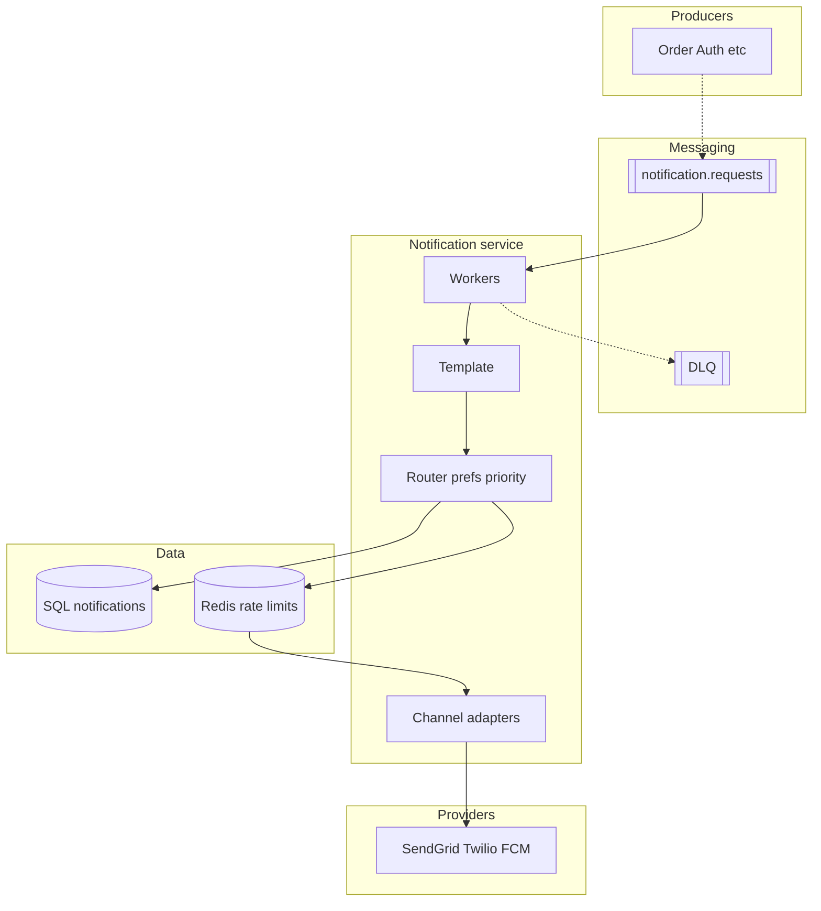

# **Notification System — HLD**

> Product services **fire-and-forget** events; notification service **queues, renders, routes, sends** via external providers (email/SMS/push). User never waits on Twilio/FCM in the hot path.

---

## **1\. Requirements**

### **Functional** *(user facing)*

* Receive **transactional** messages (OTP, order shipped, password reset) on enabled channels.
* **Choose channels** (email / SMS / push) and categories in settings.
* **Marketing** messages only if opted in; unsubscribe where required (email).

### **Non-functional**

* **Async** — producers not blocked on provider latency.
* **At-least-once** ingest; **idempotent** send (no duplicate OTP from retries).
* **Retries** with backoff; **DLQ** for poison; **priority** (OTP > transactional > marketing).
* Burst traffic (sales); per-user SMS caps; horizontal **workers** scale with Kafka partitions.

---

## **2\. API end-to-end flows**

*Interview path: event → queue → worker → provider. Preferences are setup, not hot path.*

### **Publish event** — Kafka `notification.requests` *(primary)*

**Caller:** Order, Auth, Social, … (internal). Payload: `event_type`, `user_id`, template vars, optional `idempotency_key`.

```text
1. Product service commits its own DB (e.g. order SHIPPED)
2. Publish to Kafka notification.requests (partition key = user_id)
3. Return to caller immediately — no wait for send
```

*Alternative:* `POST /v1/notifications` → persist row QUEUED → publish same topic → **202 ACCEPTED**.

---

### **Worker send path** *(no public API — core flow)*

```text
1. Consumer reads message from Kafka
2. Load template + render (event_type, locale, payload)
3. Load user preferences → drop disabled channels/categories
4. For each channel to send (push, SMS, email):
     a. idempotency_key → one notification row per (event, user, channel)
     b. If already SENT → skip (consumer retry safe)
     c. Rate-limit check (Redis) — e.g. marketing SMS/day
     d. Adapter calls provider (SendGrid / Twilio / FCM)
     e. SENT or FAILED on row; retry with backoff; max → DLQ
5. Optional: OTP policy — push failed → fallback SMS (same idempotency family)
```

---

### **PUT /v1/users/me/notification-preferences**

**Caller:** User app.

```text
1. Update channel/category toggles
2. Next worker reads fresh prefs — no retroactive cancel of in-flight Kafka msgs
```

**Other (list only):** `GET` preferences · provider **delivery webhooks** (bounce/complaint → mark FAILED, suppress email).

---

## **3\. High-Level Architecture**



```text
Producers -.-> Kafka -.-> Worker -> SQL / Redis -> Adapters -> Providers
```

---

## **4\. Data Model** *(core)*

| Entity | Purpose |
|--------|---------|
| **notifications** | `notification_id`, `user_id`, `channel`, `event_type`, `status` QUEUED\|SENT\|FAILED, **`idempotency_key` UNIQUE**, `provider_message_id` |
| **templates** | `template_id`, channel, body/version |
| **user_preferences** | `user_id`, channel, category, `enabled` |

**Kafka:** `notification.requests` (partition `user_id`); optional priority topics `…otp`, `…marketing`.

---

## **5\. Deep dives** *(what they drill)*

### **Why Kafka / async (not sync send in Order API)**

Order API finishes when **order state** is saved + **event published**. If SendGrid is slow/down, checkout/shipping must not fail. Notification lag seconds/minutes is OK for “shipped”; OTP wants **priority queue** + more workers.

---

### **Idempotency — duplicate event, duplicate consumer**

| Risk | Mitigation |
|------|------------|
| Producer retries same business event | Same **`idempotency_key`** (e.g. `order_id:SHIPPED:email`) → one row |
| Kafka **at-least-once** redelivery | Worker checks row **SENT** before calling provider |
| Provider retry from your worker | Store `provider_message_id`; use provider idempotent send API if available |

**Interview line:** *We accept duplicate **delivery attempts**; we prevent duplicate **user-visible sends** via DB uniqueness + status check.*

---

### **Retry, DLQ, provider errors**

* **5xx / timeout** from provider → retry with exponential backoff (cap N).
* **4xx** bad number/email → **fail fast**, no infinite retry; mark FAILED.
* **Poison** message (bad template) → **DLQ** + alert; fix template → manual replay.
* **Provider outage** → backlog in Kafka; scale consumers; **pause marketing** topic; OTP topic still drained first.

---

### **Priority & fan-out**

* **One event** → router may create **3 rows** (push + email + SMS) — independent status/retry per channel.
* **Separate topics or weighted consumers:** OTP/transactional processed before marketing.
* **Redis:** cap marketing SMS per `user_id` per day.

---

### **Preferences & compliance**

* Disabled channel → **skip** adapter call (row optional SKIPPED or never created).
* Transactional OTP may **bypass** marketing opt-out (state policy aloud).
* Bounce webhook → suppress address; don’t keep hammering invalid emails.

---

### **Failure handling (compact)**

| Failure | Behavior |
|---------|----------|
| Kafka unavailable | Producer retries; critical OTP may dual-write to queue backup (mention only if asked) |
| Worker crash after provider OK, before DB | At-least-once → possible duplicate; **idempotency** + provider dedupe |
| DB down on ingest | Reject **202** / don’t ack producer until durable (or accept lost notify — product choice) |

**Monitor (one line):** enqueue lag, send success by channel, DLQ depth, provider p95, bounce rate.

---
