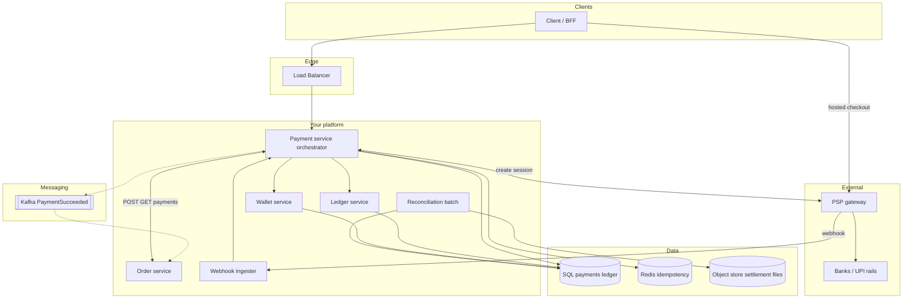

# **Payment System — HLD**

> Order owns catalog; **payment service** owns money state, PSP, webhooks, **ledger**; optional **wallet** (liability). Rails/banks = **PSP only**.

---

## **1\. Requirements**

### **Functional** *(user / buyer facing)*

* **Pay for an order** at checkout (UPI, card, debit; optional **pay from wallet**).
* **See payment status** while paying and after (processing / success / failed).
* **Retry payment** for the same order after failure or session expiry (without double-charging).
* **Refund** to original method or wallet when order is cancelled/returned (per policy).
* **Wallet (if product has it):** add money (top-up), view balance, spend balance on orders.

### **Non-functional**

* **Idempotent** create/charge/refund; **no double capture** per order.
* **Fail closed** on ambiguous paid state (no SUCCEEDED without PSP proof).
* Durable payments + append-only ledger; webhook **at-least-once** + dedupe.
* PCI: no PAN in your DB (PSP hosted checkout / tokens).
* Scale reads; money path correctness **>** availability.

---

## **2\. API end-to-end flows**

*Only paths you draw in the interview. Others listed at the end.*

### **POST /v1/payments** — `method` = UPI / card, `type` = ORDER

**Caller:** Order service (internal). **Headers:** `Idempotency-Key` (from checkout).

*(After user clicks Pay/Checkout: **order service** already created `order_id` — e.g. `POST /orders` or checkout handler — status `PAYMENT_PENDING`; client does **not** mint `order_id`. This API only creates **`payment_id`**.)*

```text
1. Order → POST /v1/payments { order_id, amount, currency, method }
2. Payment svc: UNIQUE idempotency_key → insert payment CREATED/PENDING, return payment_id
3. Payment svc → PSP API: create session/charge (provider idempotency = payment_id)
4. Response to client/BFF: payment_id, status PENDING, checkout_url / client_secret
5. User completes pay on PSP UI (redirect/SDK)
6. PSP ↔ rails (banks/UPI/NPCI) — black box; not your HTTP
7. PSP → POST /v1/webhooks/psp/{provider} (signed, may duplicate)
8. Payment svc: verify HMAC → dedupe event_id → status SUCCEEDED
9. Same txn or chained: post ledger (idempotent ledger key = payment_id)
10. Publish PaymentSucceeded → Kafka (or order polls GET — see deep dive)
11. Order svc: CONFIRMED (idempotent on payment_id)
12. (T+1) Recon job: PSP CSV vs payments/ledger rows that touched PSP
```

**Sync create response** is usually **PENDING**; final success is step 7–9, not the redirect alone.

### **POST /v1/payments again** — retry (same `order_id`)

**When user pays again after a failed / expired attempt** (new checkout click → order service calls create again with a **new** `Idempotency-Key`).

**Before inserting a new row, check existing payments for `order_id`:**

| Existing state | Action |
|----------------|--------|
| **SUCCEEDED** | Reject — order already paid |
| **PENDING** | Do **not** create #2 — return existing `payment_id` or “payment in progress” (UI polls GET) |
| **FAILED** / **EXPIRED** / **CANCELLED** only | Allow **new** `payment_id` (#2, #3, …) → new PSP session (`provider idempotency` = new `payment_id`) |

```text
1. Order → POST /v1/payments { order_id, ... }  (new Idempotency-Key)
2. Payment svc: no SUCCEEDED/PENDING → insert payment #2 PENDING → PSP session #2
3. Same webhook / ledger / notify flow as first attempt
```

Old **FAILED** / **EXPIRED** rows stay immutable (audit).

---

### **POST /v1/payments** — `method` = WALLET, `type` = ORDER

**Caller:** Order service.

```text
1. Order → POST /v1/payments { order_id, amount, method=WALLET }
2. Payment svc: lock wallet row / version; balance ≥ amount?
3. Single DB txn: debit wallet:{user}, credit merchant_payable (+ fee accounts) → payment SUCCEEDED
4. Notify order (event or direct) — no PSP call on this spend
```

Fail: insufficient balance → FAILED; order stays unpaid.

---

### **POST /v1/wallet/topups** (or POST /v1/payments `type` = TOPUP)

**Caller:** BFF / wallet service.

```text
1. POST top-up { amount, method UPI/card }
2. Same as external ORDER flow through PSP through webhook
3. On SUCCEEDED: ledger **credit** wallet:{user_id} (liability ↑), not merchant order
```

---

### **POST /v1/payments/{payment_id}/refunds**

**Caller:** Order / admin (policy).

```text
1. Validate payment SUCCEEDED; amount ≤ captured
2. If captured via PSP → PSP refund API (idempotency on refund_id)
3. If wallet pay → ledger credit wallet / debit merchant
4. Compensating ledger lines; payment → REFUNDED (full/partial)
5. Notify order / inventory per product rules
```

---

### **POST /v1/webhooks/psp/{provider}**

**Caller:** PSP only. Tied to **UPI/card/TOPUP** flows (steps 7–9 above).

```text
1. Verify signature (HMAC / cert)
2. INSERT inbound_events(event_id) — duplicate → 200 no-op
3. Map provider_payment_id → payment row; transition PENDING → SUCCEEDED|FAILED
4. On SUCCEEDED: ledger post once (same idempotency as payment_id)
5. Emit PaymentSucceeded / PaymentFailed
```

Banks do **not** call this URL — only the PSP.

---

### **GET /v1/payments/{payment_id}**

**Caller:** Order service or BFF (poll while PENDING).

```text
Return status, amount, provider_payment_id — UI “processing” until SUCCEEDED|FAILED
```

Use when Kafka lag or user closed tab; **does not** create a second charge.

---

**Other APIs (list only):**

* `GET /v1/wallet/balance` — sum(ledger) or cached + version.
* `POST /v1/reconciliation/jobs` — ops batch vs settlement file in object store.

---

## **3\. High-Level Architecture**

*Boxes match §2: every arrow is an API or webhook above.*



---

## **4\. Data Model** *(important only)*

| Table / entity | Keys / notes |
|----------------|--------------|
| **payments** | `payment_id` PK; `order_id`; `method`; `type` ORDER\|TOPUP; status PENDING→SUCCEEDED\|FAILED\|EXPIRED\|CANCELLED; `provider_payment_id`; `pending_expires_at`; **`idempotency_key` UNIQUE** |
| **inbound_events** | **`event_id` PK** — webhook dedupe |
| **ledger_entries** | append-only; `payment_id`; account_id; debit/credit; **`idempotency_key`** (one post per success) |
| **Accounts (examples)** | `wallet:{user}`, `merchant_payable:{merchant}`, `psp_clearing`, `platform_fee` |
| **wallet_accounts** | `user_id`, optional **version** for optimistic lock |
| **refunds** | `refund_id`, `payment_id`, amount, status, `idempotency_key` |

**Order SUCCEEDED via PSP (illustrative ₹500, fee ₹10):** DR `psp_clearing` 500 · CR `merchant_payable` 490 · CR `platform_fee` 10.

**Wallet:** balance changes **only** top-up / pay-with-wallet / refund-to-wallet — not plain UPI checkout.

**Recon compares:** rows where money hit PSP rails; **excludes** wallet-only order spends; **includes** top-ups paid via PSP.

---

## **5\. Deep dives** *(interview drills — failure handling here)*

### **Idempotency — where keys live, why no double charge**

| Step | Key | Effect |
|------|-----|--------|
| Checkout | **Order** sends `Idempotency-Key` (UUID per checkout attempt) | Retry POST → same `payment_id`, no second row |
| PSP create | **`payment_id`** as provider idempotency | Retry to PSP → same charge session |
| Webhook | **`event_id`** in `inbound_events` | Duplicate delivery → 200, no second ledger |
| Ledger | **`payment_id`** (or dedicated ledger idempotency) | Retry worker → no duplicate lines |

**Why:** networks and clients retry; uniqueness is **durable**, not in-memory.

---

### **One successful payment per `order_id`**

* At most **one SUCCEEDED** per `order_id` (DB / app check on create and on webhook).
* Many rows per order OK — each **retry** after FAILED/EXPIRED is a **new** `payment_id`.
* If **two** rows ever reach SUCCEEDED (bug / race): confirm order on **one** `payment_id`; **refund** the other capture + alert.

---

### **PENDING timeout — user stuck, then retry**

* **Problem:** webhook slow / lost → payment stays **PENDING** → user cannot start another pay if you block on PENDING.
* **While PENDING:** no new `payment_id` for that `order_id`; UI polls **GET /v1/payments/{payment_id}**.
* **Backup (not only webhook):** scheduled job **polls PSP** by `provider_payment_id` → move to SUCCEEDED|FAILED when PSP has truth.
* **TTL (e.g. 15–30 min, align with UPI/PSP session expiry):** if still unresolved → mark **EXPIRED** (or FAILED); cancel PSP session if API supports it → user may **retry** (new row — see retry table above).
* **Late webhook after EXPIRED:** dedupe `event_id`; if PSP says **paid** → reconcile: refund or complete + ops alert; **do not** double-confirm order if already paid on another `payment_id`.

---

### **Fail closed — never guess “paid”**

* Unknown outcome → stay **PENDING** until webhook, **PSP poll**, or **TTL expire** — not SUCCEEDED from redirect alone.
* Idempotency store down on **create** → reject create.

---

### **Payment SUCCEEDED, order update failed** *(saga — drill this)*

```text
Why money is already truth: steps 8–9 committed payment + ledger before Kafka.
What user sees: GET payment = SUCCEEDED; order may still PAYMENT_PENDING.
What we do NOT do: call PSP again to “pay again”.
Fix path:
  1. Kafka PaymentSucceeded (at-least-once) → order consumer
  2. Consumer idempotent: “if order already CONFIRMED for payment_id, ack”
  3. Retry with backoff on transient DB errors
  4. After N failures → DLQ + alert; ops replay or fix order row
  5. UI: poll GET /orders + GET /payments until aligned
```

**Why Kafka:** decouple payment commit from order DB; payment team doesn’t block on order outage. **Why DLQ:** poison message doesn’t infinite-loop; human replay after fix.

---

### **Ledger fails after PSP SUCCEEDED**

* Payment row → **PENDING_SETTLEMENT** (or SUCCEEDED + ledger flag).
* **Retry worker** posts ledger with same idempotency — **never** second PSP capture.
* Alert if stuck; recon may catch drift vs PSP file.

---

### **Webhook duplicate / reorder**

* Dedupe `event_id` first.
* State machine: only allow PENDING→SUCCEEDED once; late duplicate → no-op.
* Out-of-order FAILED after SUCCEEDED → policy + audit (usually ignore FAILED).

---

### **Wallet concurrency**

* Debit in **one DB transaction** with row lock or `version` check.
* Insufficient balance → rollback entire payment; no partial debit.

---

### **Reconciliation (one beat)**

* Nightly: PSP settlement CSV in object store vs SQL filter `method != WALLET` spend / has `provider_payment_id`.
* Mismatch → **ops alert** (missed webhook, amount drift) — not auto-refund; fix ledger or chase PSP.

---

### **Ops / scale (one line)**

**Monitor:** PENDING age, webhook lag, ledger backlog, recon mismatches, DLQ depth, impossible wallet negative.

---
