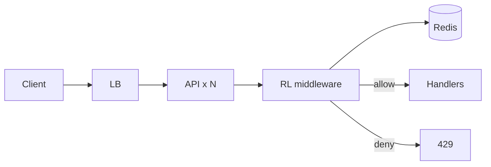

# **Rate Limiter — HLD**

> **Every API request** → one **shared** check across N stateless servers. **Redis** holds counters (not per-server memory). Over limit → **429** + `Retry-After`. Same idea as LLD `RateLimiter/` — **distributed state** + atomic ops / Lua.

---

## **1\. Requirements**

### **Functional** *(caller facing)*

* Allow or deny request; **429** when over limit.
* Headers: `X-RateLimit-Limit`, `Remaining`, `Reset`; `Retry-After` on deny.
* Optional **tiers** (free vs paid); optional per-route limits.

### **Non-functional**

* O(1) check; **race-safe** across servers; sub-ms p95 on Redis path.
* **Fail-open** (allow if Redis down) vs **fail-closed** (deny) — product choice.

---

## **2\. API end-to-end flows**

*Middleware / gateway — not a standalone product API.*

### **Per request** — check before handler

```text
1. Request hits LB → API (or API Gateway)
2. Rate limit middleware: key = user_id | API key | IP (prefer user if authed)
3. Load tier config (JWT claim / config service) → max, window, burst?
4. Redis: atomic check+consume (INCR or Lua token bucket)
5. ALLOW → forward to business handler
6. DENY → 429 + headers; handler not run
```

**Placement:** `Client → LB → [Gateway] → Rate Limiter → App`

---

### **Algorithms** *(pick one in interview)*

| Algo | Redis pattern | Note |
|------|---------------|------|
| **Fixed window** | `INCR rl:fw:{user}:{windowId}` + `EXPIRE` on first hit | Simple; **2× burst** at window edge |
| **Sliding window** | ZSET timestamps or approx sliding | Fairer edges |
| **Token bucket** | Hash `{tokens, lastRefill}` + **Lua** RMW | Allows controlled burst |

*Token bucket / complex RMW → **Lua** one round-trip (no TOCTOU across servers).*

---

## **3\. High-Level Architecture**



```text
N servers share one counter per key — global cap enforced
```

---

## **4\. Data Model** *(core)*

| Key / config | Notes |
|--------------|--------|
| `rl:fw:{userId}:{windowId}` | count; TTL = window |
| `rl:tb:{userId}` | tokens + lastRefillMs (Lua) |
| **tier config** | SQL/config: free 100/min, paid 1k/min |

Shard Redis cluster by `hash(userId)` if one node saturates.

---

## **5\. Deep dives** *(interview drills)*

### **Why not in-memory per server**

* Limit **100/min** with 10 servers → each server could allow 100 → **1000/min** without shared store.

---

### **Fail-open vs fail-closed**

| Policy | When |
|--------|------|
| **Fail-open** | General API — availability; alert on Redis errors |
| **Fail-closed** | Login, payments, sensitive — abuse risk |

Timeout on Redis → same policy as down.

---

### **Per IP vs user**

* NAT / mobile → many users one IP; **user id** when authenticated.
* DDoS: **CDN/WAF edge** first; app limiter = authenticated abuse line.

---

### **Hot key**

* One viral user = one Redis key — usually OK; advanced: local leak + global cap.

---

### **Multi-region**

* Often **per-region cap** (Redis per region); global cap = cross-region store (latency) — state trade-off.

---

### **Failure (compact)**

| Failure | Behavior |
|---------|----------|
| Redis down / timeout | fail-open or closed per policy |
| Primary failover | cluster/replica promote; brief blip |

**Monitor (one line):** 429 rate, Redis p99, deny spikes, `rl_check_timeout`.

---
