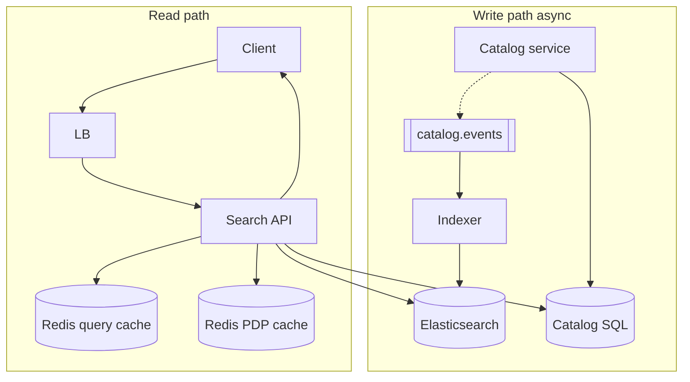

# **Search — HLD**

> **Catalog DB** = source of truth. **Elasticsearch** = keyword + filter + geo lookup (inverted index). Search returns **ids + rank**; **hydrate** title/price/image from cache/SQL. Index updates are **async** (eventual).

---

## **1\. Requirements**

### **Functional** *(user facing)*

* **Search** by text (products, restaurants, videos, …) with filters (category, price, rating, dietary, etc.).
* **Sort** by relevance, price, or distance (“near me”).
* **Autocomplete** as user types (prefix suggestions).

### **Non-functional**

* Low latency reads (p99 ~100–200ms); high **read QPS** vs catalog writes.
* Index **eventually consistent** with catalog (seconds–minutes lag OK for browse).
* Degrade if search cluster unhealthy (cache / category fallback).
* **Checkout / stock** not trusted from search alone — live inventory on order path (Amazon pattern).

---

## **2\. API end-to-end flows**

### **GET /v1/search** — main query

**Caller:** Client / BFF.

```text
1. Client → LB → Search API { q, filters, sort, lat/lng, radius, cursor }
2. Query cache (Redis search:{hash}) — hit? → reuse ranked id list (skip ES)
3. Query cache miss → Elasticsearch → ranked ids only (slim index; + light fields for rank/filter)
4. Optionally write id list to query cache (short TTL)
5. Hydrate those ids:
     a. PDP cache (Redis product:{id}) — MGET batch
     b. Any miss → Catalog SQL batch load → fill PDP cache
6. Response to client (cursor pagination)
```

*Two Redis layers: **(1) query cache** = result of this search → **ids**; **(2) PDP cache** = display fields per id. ES does not replace either — it only produces/ranks ids on query miss.*

*Search path never scans SQL with `LIKE` at scale.*

---

### **GET /v1/suggest** — autocomplete

```text
1. Client → Search API { q prefix }
2. Query lighter suggest index (edge n-gram on title) or ES completion
3. Return top N strings / ids — rate limit per IP
```

---

### **Index pipeline** — async *(no user API on hot path)*

**Trigger:** Catalog service writes product/restaurant/video → publishes **`catalog.events`** (Kafka).

```text
1. Catalog commits OLTP row (SQL/NoSQL)
2. Publish ProductCreated / ProductUpdated / Deleted
3. Indexer consumer: bulk partial update Elasticsearch doc
4. Near-real-time refresh (~1s) — new item appears in search after lag
```

**Other (list only):** internal bulk reindex job for backfill / mapping changes.

---

## **3\. High-Level Architecture**



```text
Write: Catalog → SQL → Kafka → Indexer → ES
Read:  Client → Search API → query cache? → ES? → ids → PDP cache → SQL? → Client
```

---

## **4\. Data Model** *(core)*

| Store | Holds |
|--------|--------|
| **Catalog SQL** | `sku_id`, title, description, price, category, attributes — **truth** |
| **ES index** | Same id as doc id; analyzed `title`/`description`; facets `price`, `category`; **`geo_point`**; `in_stock` hint (may be stale) |
| **Suggest** | Prefix n-grams or separate completion field |
| **Redis query cache** | `search:{hash(q,filters,sort,…)}` → ranked **ids** (and cursor page) |
| **Redis PDP cache** | `product:{sku_id}` → title, price, image, in_stock **hint** |

---

## **5\. Deep dives** *(what they drill)*

### **Why Elasticsearch (inverted index) not SQL**

SQL B-tree index is good for `id = ?`; bad for “millions of rows matching **chicken** AND **biryani**”. ES **tokenizes** text → posting lists → BM25 score. Flow: **ES → ids → hydrate** details from OLTP.

---

### **Freshness vs latency**

* User sees new listing **after** indexer catches Kafka event — **eventual**.
* Price/stock on SERP can be **stale**; **checkout** re-validates inventory (fail closed).
* **Indexer lag** spike → newer items missing from search; monitor consumer lag; don’t block catalog write on ES.

---

### **Slim ES + hydrate (two caches)**

* **Elasticsearch:** returns **ranked ids** (+ fields only needed for text score, filters, geo) — not full product rows.
* **Cache 1 — query:** same `q+filters` again → skip ES; still have only **ids**.
* **Cache 2 — PDP:** for those ids, **MGET** `product:{id}`; **SQL** only for ids missing in PDP cache.
* **Query cache hit does not mean skip SQL** unless every id hits PDP cache (common at scale).
* **Fat ES** (all display fields in index): one ES round-trip, but **every price/title change reindexes** — slower writes; slim + hydrate is the usual interview pick.

---

### **Geo + text together**

* Filter: `geo_distance` within radius (restaurants, drivers nearby on map search).
* Text relevance + distance: **filter geo first**, then score, or `function_score` — say “combine text rank with distance boost,” not full formula.

---

### **Failure & degrade**

| Failure | Behavior |
|---------|----------|
| ES down / timeout | Serve **cached** popular queries; fallback **category browse**; 503 on cold miss |
| ES yellow | Replicas; read may still work — mention ops |
| Bad/zero results | Log zero-result queries; optional spell suggest (P1) |

**Monitor (one line):** search p99, ES heap, **indexer lag**, cache hit ratio, zero-result rate.

---

### **Product variants (one line each)**

* **Swiggy:** + `open_now`, delivery radius filter on same stack.
* **YouTube:** same indexer pattern; rank may use offline click logs — don’t design ML in room.

---
