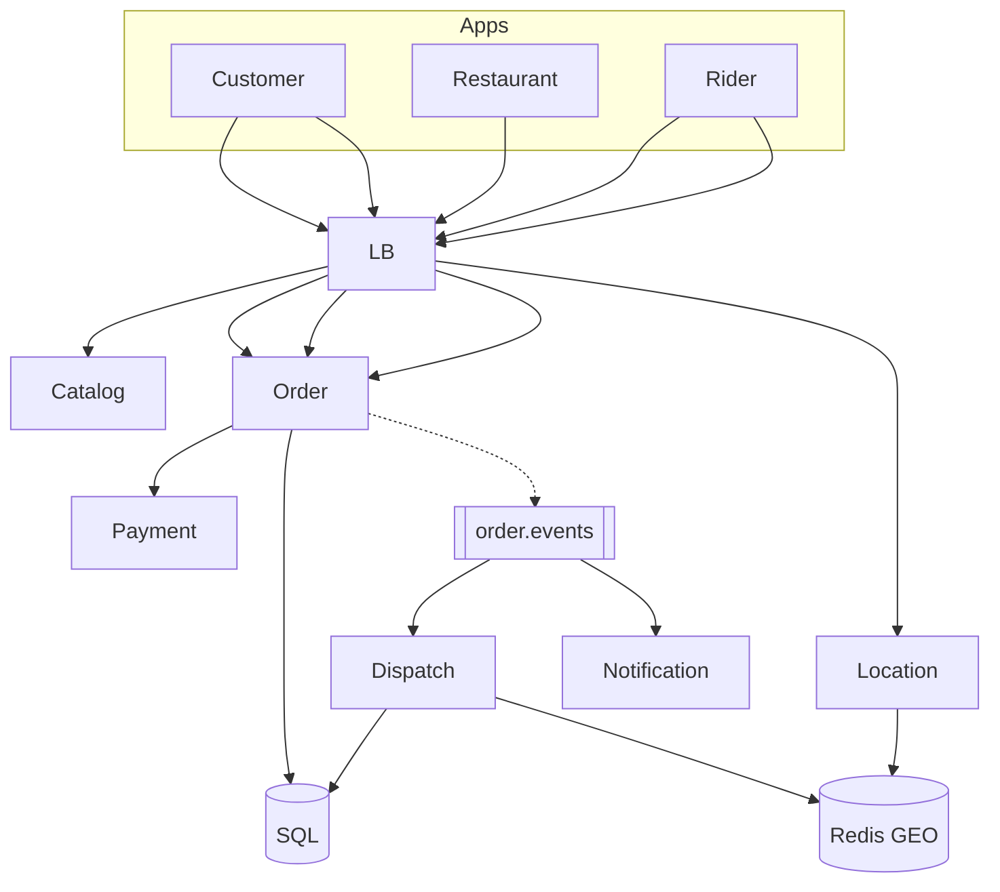

# **Swiggy — Food Delivery — HLD**

> **Order state machine** in SQL; every transition **commit → Kafka `order.events`**. Restaurants/riders/customers use **REST** (or WS for track) — **Kafka is internal only**. **Payment** = `Payment System — HLD.md`. **Dispatch** ≈ Uber geo + **atomic assign**. **Notify** = `Notification System — HLD.md`.

---

## **1\. Requirements**

### **Functional** *(user facing)*

* Find **restaurants** nearby, view **menu**, place **order**, pay.
* **Track** order status and rider on map / ETA.
* Restaurant **accepts/rejects**, marks **ready**; rider **pickup → deliver**.

### **Non-functional**

* Live status feels fast (WS/poll + push); **no double-assign** one order to two riders.
* Peak lunch **10×**; rider GPS **high write** rate; **idempotent** place order.
* Menu/search **eventually consistent**; order truth in **SQL**.

---

## **2\. API end-to-end flows**

### **Browse** — restaurants / menu *(read)*

```text
GET /restaurants?lat=&lng=  → Catalog (+ geo filter) → NoSQL menu cache
GET /restaurants/{id}/menu
Search optional → Search HLD (ES)
```

---

### **POST /v1/orders** — customer places order

**Headers:** `Idempotency-Key`.

```text
1. Customer → POST /orders { cart, address, payment }
2. Order svc: idempotency → persist SQL status PLACED (or PAYMENT_PENDING)
3. Payment service → PSP (Payment HLD) → PAID before kitchen work (policy)
4. SQL commit → publish order.events { order_id, PLACED/PAID }
5. Consumer → Notification → restaurant tablet/app (HTTPS push — not Kafka to restaurant)
6. Return order_id to customer
```

---

### **Restaurant — accept / reject / ready**

```text
POST /restaurant/orders/{id}/accept  → SQL RESTAURANT_ACCEPTED → PREPARING → Kafka
POST /restaurant/orders/{id}/reject  → CANCELLED → refund path (Payment HLD)
POST /restaurant/orders/{id}/ready-for-pickup → READY_FOR_PICKUP → Kafka → dispatch consumer
```

---

### **Dispatch + rider** — assign & deliver

```text
1. Dispatch consumer (on READY or policy earlier): Redis GEO → free riders near restaurant
2. Offer top N riders → push offer; first POST accept wins
3. Atomic: UPDATE order SET rider_id WHERE rider_id IS NULL + UNIQUE assignment(order_id)
4. Rider POST /location (high freq) → Location svc → Redis last position → Kafka location.ingest (analytics)
5. Rider POST picked-up → PICKED_UP → Kafka → customer notify + track
6. Rider POST delivered → DELIVERED → Kafka → notify; payment settle COD if any
```

---

### **GET /orders/{id}/track** — customer live view

```text
Poll or WebSocket: order status from SQL timeline + rider lat/lng from Redis (throttled ETA — maps provider black box)
Offline updates → Notification + Chat optional (Chat HLD)
```

**Other (list only):** cancel policy · ratings P1 · surge pricing (read demand; dispatch unchanged).

---

## **3\. High-Level Architecture**



```text
SQL first → Kafka → notify restaurant · dispatch · push
Partners: REST only · Kafka never exposed to restaurant/rider apps
```

---

## **4\. Data Model** *(core)*

| Entity | Notes |
|--------|--------|
| **orders** | `order_id`, restaurant_id, status, rider_id, payment_status, address snapshot |
| **order_events** | append-only timeline for GET order |
| **assignments** | `order_id` UNIQUE active offer; OFFERED \| ACCEPTED \| EXPIRED |
| **orders status** | PLACED → … → READY_FOR_PICKUP → RIDER_ASSIGNED → PICKED_UP → DELIVERED \| CANCELLED |
| **rider location** | Redis GEO + last ping TTL |

---

## **5\. Deep dives** *(what they drill)*

### **SQL then Kafka (not sync chain)**

* Restaurant slow must **not** block place-order response. After commit, **async** consumers notify, dispatch, analytics.
* **GET /orders** = last **committed** SQL state if Kafka lags.

---

### **No double-assign**

* One **active rider** per order: conditional SQL + **UNIQUE(order_id)** on assignment.
* Offer **TTL** → re-offer next rider if no accept.

---

### **Dispatch ≈ Uber slice**

* **Redis GEO** nearby + **online/free** filter; rank distance/ETA; not full “Design Uber” — same geo index idea.

---

### **Location flood**

* Rider POST location **does not** push every ping to customer; **throttle** map updates; stale rider → treat offline.

---

### **Payment / cancel**

* Pay fail → don’t confirm kitchen. Reject/timeout → **CANCELLED** + refund (Payment HLD).
* **COD:** confirm to restaurant on place; collect on delivery — ops variant.

---

### **Failure (compact)**

| Failure | Behavior |
|---------|----------|
| Kafka lag | Stale push; SQL GET still correct |
| Redis GEO down | Delay dispatch / smaller pool; alert |
| DB down | Stop new orders |

**Monitor (one line):** time-to-assign, double-assign attempts (zero), consumer lag, per-state funnel.

---
