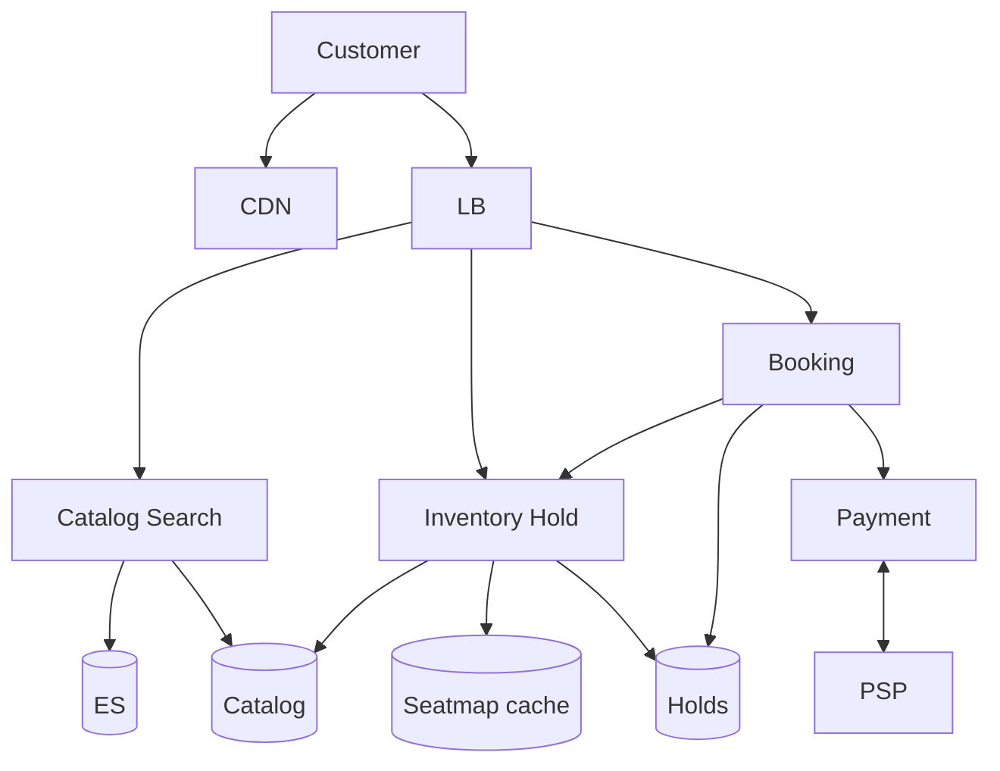

# **Ticket Booking — HLD**

> **Hold + TTL** on seats → **book with `hold_id`** → **Payment HLD** → seats **SOLD**. Like Amazon inventory race, but seats need **early hold** (finite, visual map). **No double-book:** unique `(show_id, seat_id)`. Search = `Search — HLD.md`.

---

## **1\. Requirements**

### **Functional** *(user facing)*

* Browse **shows**, view **seat map** (available / held / sold).
* **Select seats** → short **hold** while paying → **confirm booking** + ticket (QR).
* View / cancel booking per policy.

### **Non-functional**

* **No oversell**; hold **5–10 min TTL** typical.
* Hot **show_id** spike (blockbuster); idempotent book + pay.
* Seat map read can be **slightly stale**; **hold API** is conflict truth.

---

## **2\. API end-to-end flows**

### **Browse** — shows / seat map *(read)*

```text
GET /shows/{show_id}/seats  → Inventory → Redis seatmap cache → NoSQL per show_id
GET /search?q=              → Search HLD (movies/shows)
```

*Map may show seat “available” but **POST /holds** returns 409 if taken — user refreshes.*

---

### **POST /v1/shows/{show_id}/holds** — lock seats

```text
1. Client sends seat_ids[] (all-or-nothing)
2. Inventory svc: atomic — each (show_id, seat_id) must be AVAILABLE
3. Mark HELD, create hold_id + expires_at; hold_seats lines in SQL (or same store)
4. Return hold_id, expires_at
5. Fail any seat → 409, no partial hold
```

**TTL sweeper:** expired hold → seats back to AVAILABLE.

---

### **POST /v1/bookings** — pay with hold

**Headers:** `Idempotency-Key`. Body: **`hold_id`** + payment method.

```text
1. Validate hold: not expired, still HELD, owned by user
2. Create booking PAYMENT_PENDING in SQL (price snapshot)
3. Payment service POST /payments { booking_id, amount } — Payment HLD
4. PSP webhook SUCCEEDED → idempotent confirm:
     booking CONFIRMED · seats SOLD · delete hold rows
5. Notification → ticket/QR email (Notification HLD)
6. Pay fail or hold expires during pay → release seats · booking FAILED/CANCELLED
```

*Do **not** book without **hold_id**; do **not** SOLD without **paid** (unless free event).*

---

### **DELETE /v1/holds/{hold_id}** — user abandons

```text
Release HELD → AVAILABLE before TTL
```

**Other:** GET booking · cancel/refund policy · admin create show P1.

---

## **3\. High-Level Architecture**



```text
Read:  seat map (cache/NoSQL) · Search
Write: HOLD → BOOK + Payment → SOLD on webhook
```

---

## **4\. Data Model** *(core)*

| Entity | Notes |
|--------|--------|
| **seats** | `(show_id, seat_id)` status AVAILABLE \| HELD \| SOLD — shard by **show_id** |
| **holds** | `hold_id`, user_id, `expires_at` |
| **hold_seats** | hold_id → seat_ids |
| **bookings** | booking_id, hold_id, status, payment_status |
| **UNIQUE** | `(show_id, seat_id)` — one live seat row |

---

## **5\. Deep dives** *(what they drill)*

### **Hold vs Amazon cart**

* **Amazon:** cart doesn’t reserve; race at **place order**.
* **Tickets:** must **hold early** — `hold_id + TTL` is checkout unit; two users same seat → second **hold** fails.

---

### **Stale map vs hold**

* Cached map lags; **hold** does conditional update on truth store. 409 → pick other seats.

---

### **Payment saga** *(Payment HLD)*

* **PENDING pay + hold TTL expires** → release seats even if user “still paying”; late webhook → refund/reconcile.
* **Pay OK, confirm DB fails** → refund + ops; webhook idempotent.
* **Two tabs:** second hold on same seat fails.

---

### **Hot show scale**

* Partition inventory by **show_id**; avoid locking whole venue; per-seat row updates.

---

### **Failure (compact)**

| Failure | Behavior |
|---------|----------|
| Hold/confirm DB unsafe | Reject (fail closed) |
| Redis down | Slower holds; SQL + sweeper |
| Double SOLD | Zero tolerance alert — UNIQUE prevents |

**Monitor (one line):** hold conflict rate, TTL expirations, payment PENDING vs hold expiry, double-sold alarms.

---

### **Deliverable after pay**

* **Digital ticket** (QR) — like Amazon **Shipment** async: generate QR, notify user; no physical dispatch unless mail.

---
