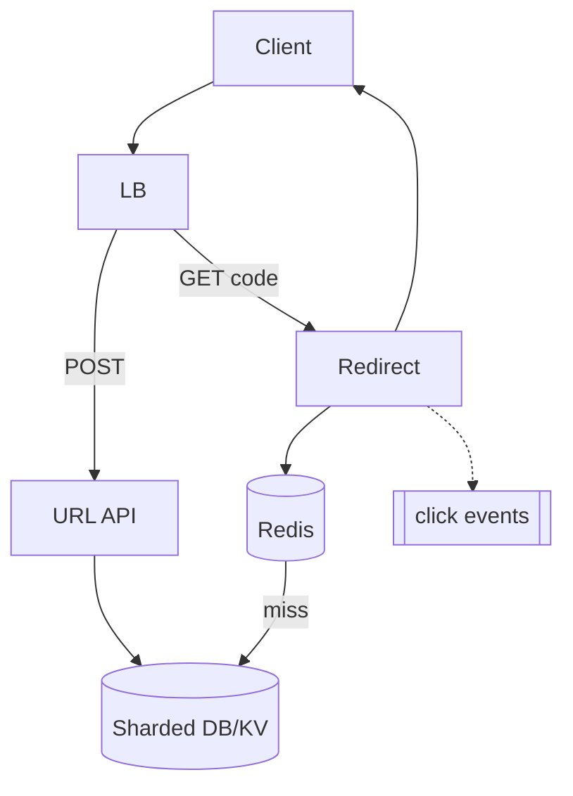

# **URL Shortener — HLD**

> **Read-heavy** (100:1 redirect:create). **GET /{code}** → cache-aside → **301/302**; analytics **async** (never block redirect). **POST** → unique `short_code` → DB primary then ack. Shard by **hash(short_code)**.

---

## **1\. Requirements**

### **Functional** *(user facing)*

* Create short link from long URL; **redirect** on visit.
* Optional: custom alias, expiry, delete, click analytics.

### **Non-functional**

* Low redirect latency; HA; durable mappings (immutable once created).
* Read-after-write on create; horizontal scale on redirects.

---

## **2\. API end-to-end flows**

### **POST /v1/urls** — create

**Headers:** optional `Idempotency-Key` for safe retries.

```text
1. Client → { long_url, custom_alias?, expires_at? }
2. Generate short_code (base62 / counter+encode) or validate alias UNIQUE
3. Insert DB shard (hash short_code) — collision → regenerate code
4. Return { short_url, short_code } after primary commit
5. (Optional) warm cache — usually lazy on first redirect
```

*Same long URL dedupe = product choice, not required.*

---

### **GET /{short_code}** — redirect *(hot path)*

```text
1. LB → Redirect service (stateless)
2. Redis GET short_code → hit: long_url (check expiry if cached meta)
3. Miss → DB shard by hash(short_code) → read primary or caught-up replica
4. Not found / expired → 404
5. Return 301 (permanent) or 302 with Location: long_url
6. Fire-and-forget: publish click event → Kafka (timestamp, code, geo, referrer)
   — analytics failure does NOT block step 5
```

---

## **3\. High-Level Architecture**



```text
Create: API → DB (write path)
Redirect: Redis → miss → DB → 301/302 · clicks async
```

---

## **4\. Data Model** *(core)*

| Entity | Notes |
|--------|--------|
| **urls** | `short_code` PK, `long_url`, `created_at`, `expires_at?`, `owner_id?` |
| **custom alias** | global UNIQUE on `short_code` or namespace `UNIQUE(owner_id, alias)` |

Index: PK = redirect lookup. Immutable mapping → easy cache (TTL = min(default, time-to-expiry)).

---

## **5\. Deep dives** *(interview drills)*

### **Why cache-aside on redirect**

* ~100:1 read:write; hot codes hit Redis; DB protected.
* Mapping immutable → no invalidation on update (expiry: TTL + check on miss).

---

### **Sharding**

* `shard = hash(short_code) % N` — route read/write to one shard.
* Spreads storage + QPS; not for “faster search” (lookup is always by PK).

---

### **Code generation & collisions**

* Random/base62: insert UNIQUE; on conflict regenerate.
* Counter per shard + encode: predictable uniqueness with coordination.

---

### **Consistency**

* Create: ack after **primary** commit (read-after-write).
* Redirect miss: primary or replica with **acceptable lag** policy; stale replica → rare wrong redirect risk — say “read from caught-up replica or primary on miss.”
* Shard **no quorum** → **503** on writes; don’t invent mappings. Cache may still serve old hits.

---

### **301 vs 302**

* **301** — permanent (browser may cache); good for stable short links.
* **302** — temporary; easier to change destination later.

---

### **Failure (compact)**

| Failure | Behavior |
|---------|----------|
| Redis down | Bypass → DB; stampede protection (singleflight / brief lock) |
| Primary down | Promote replica; reroute writes |
| Kafka down | Redirect OK; buffer/drop analytics briefly |

**Monitor (one line):** redirect p95, cache hit ratio, shard replication lag, 404 vs 503 rate.

---
