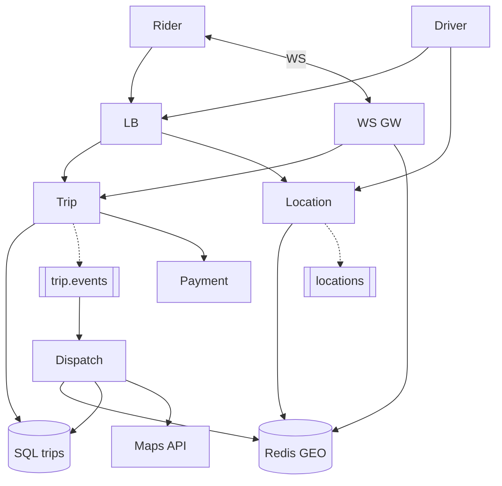

# **Uber — Ride Hailing — HLD**

> **Request trip** → **match** nearby driver (Redis **GEO**) → **atomic assign** → live **location** stream → complete → **Payment HLD**. Maps/routing = **external**. **Dispatch** same idea as Swiggy rider assign. **WS** for rider live trip (Chat/track pattern).

---

## **1\. Requirements**

### **Functional** *(user facing)*

* Set **pickup/drop**, see **fare estimate**, **request ride**.
* **Track** driver on map; trip states through **pickup → drop**.
* Driver **online/offline**, accept ride; **pay** at end (card/wallet).

### **Non-functional**

* Fast **nearby-driver** lookup; **high GPS write** rate from drivers.
* **No double-assign** one trip to two drivers; idempotent **request trip**.
* Trip state **consistent** in SQL; GEO index can be **slightly stale**.

---

## **2\. API end-to-end flows**

### **POST /v1/trips/estimate** — fare preview

```text
Rider → Trip svc → Maps provider (route/distance black box) → fare range (+ surge if any)
```

---

### **POST /v1/trips** — request ride

**Headers:** `Idempotency-Key`.

```text
1. Rider → POST /trips { pickup, drop }
2. Trip svc: persist SQL status REQUESTED → MATCHING
3. Publish trip.requested → Kafka
4. Return trip_id to rider (WS subscribe or poll GET)
```

---

### **Match path** — internal (Dispatch consumer)

```text
1. Consumer reads trip.requested
2. Query Redis GEO: radius around pickup, filter ONLINE · not ON_TRIP · fresh ping
3. Rank (distance, ETA, rating) — Maps provider for ETA optional
4. Offer driver(s): push to driver app; OFFERED row + TTL
5. Driver POST …/accept → atomic UPDATE trips SET driver_id WHERE driver_id IS NULL
6. Success → DRIVER_ASSIGNED → Kafka trip.events → rider WS/push
7. No accept in TTL → widen radius / next driver / cancel policy
```

---

### **Driver location** — high frequency

```text
POST /drivers/{id}/location { lat, lng, ts } → Location svc → Redis GEO + meta
Optional: Kafka driver.locations for analytics (partition geohash)
Rider map: read Redis last position — throttle UI (not every ping)
```

---

### **Trip milestones** — driver REST

```text
arrived → start → complete → fare_final → Payment service (Payment HLD)
Rider GET /trips/{id} or WS stream for status + driver snapshot
```

**Other:** cancel (policy/fees) · rating · surge on estimate only.

---

## **3\. High-Level Architecture**



```text
GPS → Redis GEO · Match reads GEO writes SQL assign · Rider live = WS + Redis
```

---

## **4\. Data Model** *(core)*

| Entity | Notes |
|--------|--------|
| **trips** | `trip_id`, rider_id, `driver_id` nullable, status, pickup/drop, fare |
| **trip_offers** | OFFERED \| ACCEPTED \| EXPIRED; guard double-offer |
| **drivers** | ONLINE \| OFFLINE \| ON_TRIP |
| **Redis** | GEO set + per-driver status, last_ts |

**States:** REQUESTED → MATCHING → ASSIGNED → EN_ROUTE → ARRIVED → IN_PROGRESS → COMPLETED \| CANCELLED

---

## **5\. Deep dives** *(what they drill)*

### **Geo index**

* **Redis GEO** (or geohash cells): “drivers within 2 km of pickup.”
* **Stale ping** → treat driver offline; don’t match ghosts.

---

### **Atomic assign (no double-book)**

```text
UPDATE trips SET driver_id=? WHERE trip_id=? AND driver_id IS NULL
+ driver ON_TRIP + UNIQUE active offer per trip
```
Second accept loses race → 409.

---

### **Location scale vs rider UX**

* Ingest **many writes/s**; rider sees **throttled** position (5–10s).
* Kafka optional for history; **match uses Redis hot state**.

---

### **Real-time**

* **WebSocket** per `trip_id` for status; disconnect → **GET trip** poll (Chat pattern).
* Push notification if app background (Notification HLD).

---

### **vs Swiggy**

* Uber: **continuous GPS** + match at request.
* Swiggy: order → kitchen → dispatch at **ready**; same **offer/accept atomic** idea.

---

### **Failure (compact)**

| Failure | Behavior |
|---------|----------|
| No drivers | Cancel or retry match / surge message |
| GEO down | Degraded match; alert |
| WS down | Poll GET trip |

**Monitor (one line):** time-to-assign, double-assign (zero), stale driver %, location ingest lag.

---
