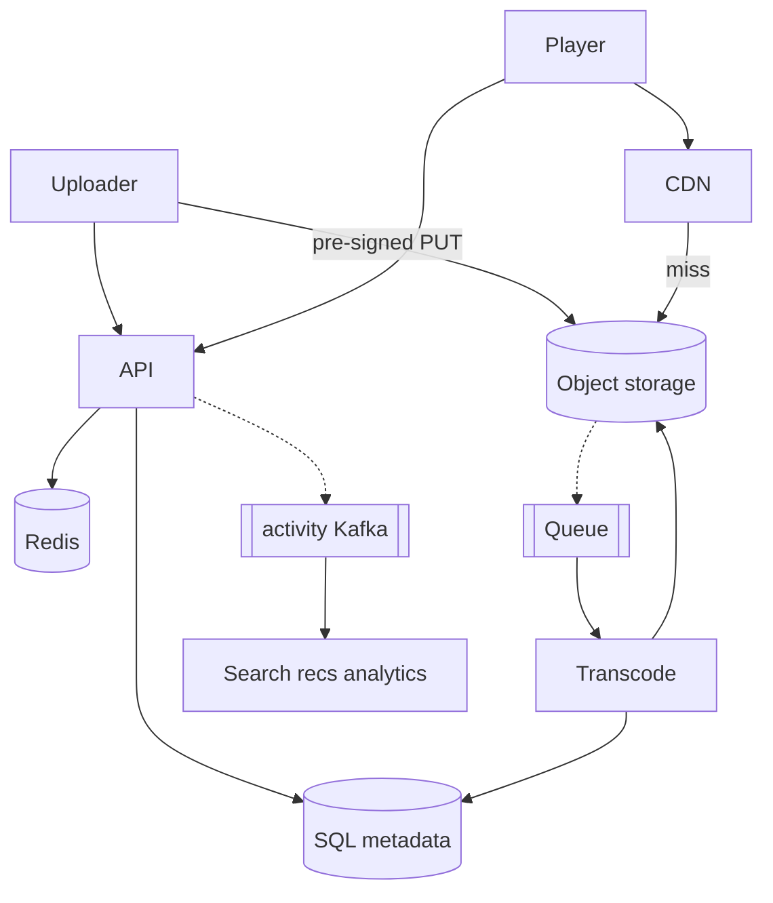

# **YouTube — HLD**

> **API** = metadata + auth; **bytes** never through API. Upload **pre-signed PUT** to object storage → **async transcode** → status **READY** → player reads **manifest + segments from CDN**. Search/recs/views = **eventual** (Kafka/indexer). **ABR** in client player.

---

## **1\. Requirements**

### **Functional** *(user facing)*

* Upload / update / delete video; **watch** with adaptive quality.
* Search; like/comment; subscribe; channel + visibility (public/private/unlisted).
* Home / related recommendations (P1); notifications (P1).

### **Non-functional**

* Low buffering playback; horizontal scale; durable storage.
* **Strong** path for auth, visibility, **READY** gate; **eventual** for search, feeds, view counters.
* VOD first (live = separate path).

---

## **2\. API end-to-end flows**

### **Upload** — init → PUT bytes → complete → transcode

```text
1. POST /v1/uploads/init — auth; row video_id status=UPLOAD_PENDING; return pre-signed PUT URL (time-limited)
2. Client PUT file directly to object storage (not through API body)
3. POST /v1/videos/{id}/complete — title/tags/visibility (draft metadata OK)
4. Verify object exists (head object or ObjectCreated event) → UPLOADED / PROCESSING
5. Enqueue transcode job (Kafka/queue) — no transcode until original bytes exist
6. Worker: read original → multi-bitrate segments + HLS/DASH manifest → write S3
7. SQL status=READY + manifest_location; on failure after retries → FAILED (no play URL)
```

*Do **not** mark READY on complete alone without object + successful transcode.*

---

### **Watch** — one API call, then CDN

```text
1. GET /v1/videos/{id} — metadata; if READY → playback.manifest_url (CDN)
2. If PENDING/PROCESSING/FAILED → no playable URL
3. Player fetches manifest + segments from CDN only (API never streams GB video)
4. Client ABR: switch 1080/720/480 from buffer + bandwidth
```

---

### **Search** *(sketch)*

```text
GET /v1/search?q= → Elasticsearch (inverted index) → video_ids → hydrate Redis/SQL
Indexer consumes video events from SQL/Kafka — lag OK after READY
```

**Other (list):** like/comment/subscribe · GET /home (rec service + cache) · view events → Kafka → analytics.

---

## **3\. High-Level Architecture**



```text
Control plane: API + SQL · Data plane: S3 + CDN · Async: transcode + indexers
```

---

## **4\. Data Model** *(core)*

| Entity | Notes |
|--------|--------|
| **videos** | `video_id`, channel, title, visibility, `original_key`, `manifest_location`, **status** UPLOAD_PENDING→UPLOADED→PROCESSING→**READY**\|FAILED |
| **likes** | UNIQUE(user_id, video_id) |
| **comments** | shard by `video_id` |
| **S3** | `videos/{id}/original` · renditions + segments + manifest |
| **search index** | title, tags, channel — eventual from events |

---

## **5\. Deep dives** *(interview drills)*

### **Why pre-signed URL**

* Init on **your** API (auth, quota, video row).
* Storage signs short-lived **PUT**; uploader sends bytes **direct to S3**.
* “Direct upload” = skip API for bytes, not skip API entirely.

---

### **SQL vs Elasticsearch**

| Store | Use |
|-------|-----|
| **SQL** | users, videos, subs, uniqueness, visibility, READY |
| **ES** | keyword search at scale (inverted index) — not SQL `LIKE` |

Flow: search ES → ids → hydrate SQL/Redis.

---

### **Original + transcoded**

* **Original** — retry transcode, re-encode, moderation audit.
* **Segments + manifest** — what CDN serves; **ABR** picks rendition in player.

---

### **Consistency**

| Stronger | Eventual |
|----------|----------|
| READY, visibility, auth | search index, home feed, view counts |

Publish manifest to API response only when **READY** (and policy allows).

---

### **Failure (compact)**

| Failure | Behavior |
|---------|----------|
| complete without S3 object | stay PENDING; never READY |
| transcode fail | FAILED; retry job / re-upload |
| Redis down | cache-aside → SQL |
| Kafka lag | watch still works; search/recs stale briefly |

**Monitor (one line):** transcode queue depth, % READY, CDN rebuffer, search indexer lag.

---
